

پروژه‌ی درس تحلیل داده · پاییز ۱۴۰۵ · مسیر الف: NYC TLC Trip Record Data · گزارش فاز ۱

<h1>کجا و کِی تاکسی لازم می‌شود؟ پیش‌بینی یک‌روز‌جلوتر تقاضای ساعتی تاکسی زرد در نواحی نیویورک</h1>

Day-ahead hourly pickup demand by taxi zone — NYC Yellow Taxi, January–June 2024

<b>20.33M</b>سفر خام در شش فایل ماهانه

<b>1.68%</b>سطر حذف‌شده با ۸ قاعده‌ی «حذف»

<b>134</b>ناحیه‌ی فعال = ۹۹٫۵٪ سوارشدن‌ها

<b>20.0%</b>WAPE بهترین خط مبنا روی اعتبارسنجی

<b>دانشجو:</b> فرناز حاج‌منوچهری — <b>شماره‌ی دانشجویی:</b> <bdi dir="ltr">401100111</bdi>

<b>فاز:</b> ۱ — فهم مسئله، شناخت داده، ممیزی کیفیت و تحلیل اکتشافی

<b>کد و داده:</b> مخزن پروژه، پوشه‌های <code>taxidemand/</code> و <code>artifacts/phase1/</code> — برچسب <code>phase-1</code>

1. خلاصه‌ی اجرایی
2. صورت‌بندی مسئله و سه سؤال نامزد
3. منشأ داده و نحوه‌ی تولید آن
4. ممیزی ساختار داده
5. ممیزی کیفیت و تصمیم‌های پاک‌سازی
6. ممیزی زمان سفر
7. سازگاری متغیرهای سفر
8. ساخت‌نمای مکانی اولیه
9. تحلیل تک‌متغیره و چندمتغیره
10. سؤال سری زمانی و پنل ناحیه–ساعت
11. خطر نشت اطلاعات
12. طراحی تقسیم و خط مبنا
13. بخش‌های پیشنهادی، اخلاق و محدودیت‌ها

## خلاصه‌ی اجرایی

این گزارش داده‌ی سفرهای **تاکسی زرد نیویورک** در شش ماه اول ۲۰۲۴ را (۲۰٬۳۳۲٬۰۹۳ سفر) از فایل خام تا یک پنل آماده‌ی پیش‌بینی بررسی می‌کند. سؤال اصلی پروژه این است: **«تعداد سوارشدن‌ها در هر ناحیه‌ی تاکسی و هر ساعت فردا چقدر خواهد بود؟»** پاسخ این سؤال به اپراتورها و رانندگان کمک می‌کند ناوگان را پیش از اوج تقاضا جابه‌جا کنند.

- داده **مشاهده‌ای و اداری** است: تاکسی‌متر آن را ثبت می‌کند، نه یک آزمایش کنترل‌شده. حدود ۱۰٪ سطرها (۱٬۹۷۵٬۹۸۵ سفر) یک **بلوک فراداده‌ی گمشده** دارند که تصادفی نیست: سهم آن از ۴٫۷٪ در ژانویه به ۱۱٫۹٪ در مارس می‌رسد و در ساعت ۴ صبح به ۲۶٪ می‌رسد.
- تقاضا به‌شدت **متمرکز** است: ۱۰ ناحیه ۳۷٫۷٪ و منهتن ۸۹٫۵٪ سوارشدن‌ها را دارند (ضریب جینی بین نواحی = ۰٫۸۵).
- سری زمانی **دو فصل‌پذیری قوی** دارد: روزانه (اوج ساعت ۱۸ حدود ۱۲ برابر کف ساعت ۴) و هفتگی. ۱۶ روز غیرعادی پیدا شد که بخشی از آن‌ها تعطیلات رسمی‌اند.
- بهترین خط مبنای ساده (میانگین «ناحیه × روز هفته × ساعت» روی داده‌ی آموزش) روی ماه اعتبارسنجی به WAPE = 20.0% می‌رسد. این عدد، و نه میانگین ساده، معیار سنجش هر روش پیچیده‌تر است.

## صورت‌بندی مسئله و سه سؤال نامزد

**نیاز واقعی.** تقاضای تاکسی در طول روز و بین نواحی بسیار نامتوازن است. رانندگان تاکسی زرد بیشتر «خیابانی» مسافر می‌گیرند و اگر ندانند تقاضا کجا شکل می‌گیرد، زمان زیادی را خالی رانندگی می‌کنند. یک پیش‌بینی **یک‌روز‌جلوتر** از تعداد سوارشدن‌ها در هر ناحیه و هر ساعت می‌تواند از سه تصمیم پشتیبانی کند:

1. **برنامه‌ریزی شیفت و ناوگان:** چند خودرو، چه ساعتی و در کدام منطقه.
2. **هشدار تقاضای غیرعادی:** اگر تقاضای واقعی خیلی از پیش‌بینی فاصله بگیرد (رویداد، برف، اختلال مترو)، باید علت را بررسی کرد.
3. **برنامه‌ریزی تنظیم‌گر (TLC):** مثلاً جای ایستگاه‌های تاکسی در فرودگاه‌ها و ارزیابی اثر سیاست‌هایی مانند congestion pricing (ژانویه‌ی ۲۰۲۵، خارج از بازه‌ی این پروژه).

خروجی تحلیل **یک عدد پیش‌بینی برای هر ناحیه و هر ساعت** است. همراه آن بازه‌ی عدم‌قطعیت و فهرست نواحی و ساعت‌هایی که پیش‌بینی در آن‌ها قابل اعتماد نیست هم گزارش می‌شود. سؤال «بهترین مدل کدام است» هدف پروژه نیست.

### سه سؤال نامزد

**سؤال ۱ (انتخاب‌شده) — پیش‌بینی تقاضای ساعتی ناحیه‌ها.** با اطلاعاتی که تا ساعت ۰۰:۰۰ روز D در دست است، تعداد سوارشدن‌ها در هر ناحیه‌ی فعال و هر ساعت روز D+1 چقدر است؟ واحد پیش‌بینی: ناحیه × ساعت.

**سؤال ۲ — پیش‌بینی مدت سفر در لحظه‌ی سوارشدن (ETA).** با دانستن ناحیه‌ی مبدأ و مقصد و زمان، مدت سفر چقدر است؟ مشکل اصلی: `trip_distance` و کرایه پس از پایان سفر معلوم می‌شوند، پس بیشتر ستون‌ها در لحظه‌ی پیش‌بینی در دسترس نیستند.

**سؤال ۳ — تشخیص روزها و ساعت‌های غیرعادی.** کدام روزها یا ساعت‌ها به‌طور معنادار از الگوی معمول فاصله دارند و آیا علت آن خطای داده است یا رخداد واقعی؟

**سؤال ۴ — پیش‌بینی انعام.** انعام نقدی در داده ثبت نمی‌شود (جدول ۵): ۹۴٫۶٪ سفرهای کارتی انعام ثبت‌شده دارند و سفرهای نقدی تقریباً هیچ. پس برچسب برای ۱۳٫۵٪ سفرها به‌طور سیستماتیک صفر است و این سؤال کنار گذاشته شد.

سؤال ۱ انتخاب شد، چون (الف) مستقیماً از یک تصمیم عملیاتی پشتیبانی می‌کند؛ (ب) هدف آن (شمارش سوارشدن) از تعداد سطرها به دست می‌آید و به ستون‌های پرخطای کرایه وابسته نیست؛ (ج) الزام سری زمانی مسیر الف را به‌صورت طبیعی پوشش می‌دهد؛ و (د) سؤال ۳ (روزهای غیرعادی) روی همان پنل ناحیه–ساعت قابل بررسی است و در بخش ۶ هم به آن پرداخته شده است.

## منشأ داده و نحوه‌ی تولید آن

| ویژگی | توضیح |
|---|---|
| ناشر | NYC Taxi & Limousine Commission (TLC) — صفحه‌ی رسمی TLC Trip Record Data |
| نوع سرویس انتخابی | Yellow Taxi (TPEP) — فقط یک نوع سرویس، برای کنترل حجم و یکدست بودن رفتار |
| بازه | ۱ ژانویه تا ۳۰ ژوئن ۲۰۲۴ (شش فایل Parquet ماهانه، در مجموع ≈ ۳۴۲ مگابایت) |
| فایل کمکی | `taxi_zone_lookup.csv`: نگاشت ۲۶۵ شناسه‌ی ناحیه به borough و نام ناحیه |
| نحوه‌ی تولید | تاکسی‌متر و سامانه‌ی TPEP هر سفر را ثبت می‌کنند و ارائه‌دهندگان فناوری (vendor) آن را به TLC می‌فرستند. داده **مشاهده‌ای و اداری** است و فرایند کنترل‌شده‌ای پشت آن نیست. |
| واحد مشاهده | یک سفر (از سوارشدن تا پیاده‌شدن)؛ شناسه‌ی یکتای سفر وجود ندارد |
| مکان | فقط در سطح **ناحیه‌ی تاکسی** (۲۶۳ ناحیه + دو کد «نامعلوم/خارج از NYC»)؛ مختصات GPS از ۲۰۱۶ به بعد منتشر نمی‌شود |
| یکپارچگی | SHA-256 هر فایل در `params.toml` ثبت و در `taxidemand/fetch.py` بررسی می‌شود |

Table: شناسنامه‌ی داده.

**محدودیت‌های تولید داده.** (۱) داده فقط سفرهایی را نشان می‌دهد که **انجام شده‌اند**؛ تقاضای برآورده‌نشده (مسافری که تاکسی پیدا نکرد) دیده نمی‌شود. پس «تقاضا» در این پروژه در واقع **تقاضای محقق‌شده** است. (۲) سفرهای Uber/Lyft (FHVHV) و تاکسی سبز در فایل‌های جداگانه‌اند. سهم تاکسی زرد از کل بازار سفر کم است و جای خالی آن در بیرون منهتن بیشتر است. (۳) TLC فایل‌ها را گاهی بازنشر و اصلاح می‌کند، و همین سطرهای خارج از ماه را توضیح می‌دهد (بخش ۵). (۴) کدهای vendor و payment از دیکشنری داده‌ی به‌روز TLC گرفته شده‌اند: vendor ۱ = Creative Mobile Technologies، ۲ = Curb Mobility، ۶ = Myle Technologies؛ payment ۰ = Flex Fare.

## ممیزی ساختار داده

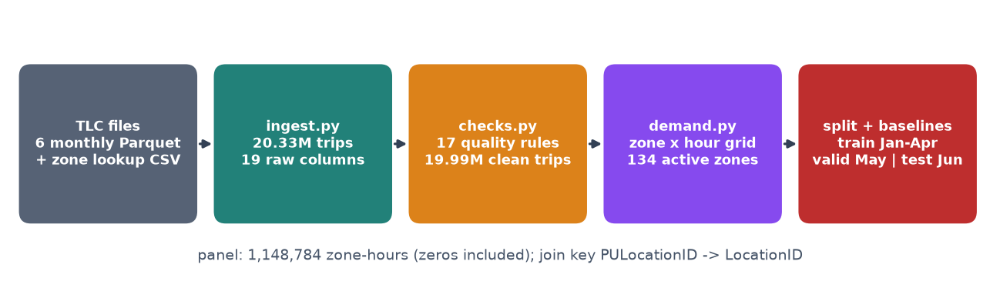

جریان داده در فاز ۱: از فایل‌های خام تا پنل ناحیه–ساعت و تقسیم زمانی. هر جعبه یک ماژول در <code>taxidemand/</code> است.

| فایل | سطرها | | فایل | سطرها |
|---|---|---|---|---|
| 2024-01 | 2,964,624 | | 2024-04 | 3,514,289 |
| 2024-02 | 3,007,526 | | 2024-05 | 3,723,833 |
| 2024-03 | 3,582,628 | | 2024-06 | 3,539,193 |

Table: تعداد سطر هر فایل ماهانه؛ مجموع ۲۰٬۳۳۲٬۰۹۳ سطر و ۱۹ ستون خام.

ستون‌ها چهار گروه دارند: **شناسه و زمان** (`VendorID`، `tpep_pickup_datetime`، `tpep_dropoff_datetime`)، **مکان** (`PULocationID`، `DOLocationID` که به `LocationID` فایل lookup وصل می‌شوند)، **ویژگی سفر** (`passenger_count`، `trip_distance`، `RatecodeID`، `store_and_fwd_flag`، `payment_type`) و **۱۰ ستون پولی** (`fare_amount` تا `Airport_fee`). نوع ستون‌ها هنگام خواندن کوچک می‌شود (مثلاً int16 برای ناحیه و float32 برای مبلغ)، تا ۲۰ میلیون سطر در حدود ۱٫۷ گیگابایت حافظه جا شود. جدول کامل در `tables/schema.csv` آمده است.

- **کلید اتصال:** همه‌ی ۲۶۲ شناسه‌ی مبدأ دیده‌شده در lookup وجود دارند (۰ سطر بی‌جفت). ۳ ناحیه از ۲۶۳ ناحیه‌ی واقعی در کل شش ماه هیچ سوارشدنی ندارند.
- **کلید یکتا:** داده شناسه‌ی سفر ندارد. تکرار را با ترکیب ۱۳ ستون خام بررسی کردیم و فقط **۱ سطر** تکراری بود.
- **متغیرهای زمانی:** زمان‌ها به وقت محلی نیویورک و بدون منطقه‌ی زمانی ذخیره شده‌اند. این نکته در تغییر ساعت تابستانی دیده می‌شود (بخش ۶).

## ممیزی کیفیت و تصمیم‌های پاک‌سازی

برای هر مشکل یک قاعده‌ی بولی در `taxidemand/checks.py` تعریف شد. هر قاعده یک تصمیم صریح دارد: حذف، نگه‌داشتن با پرچم، یا کدگذاری دوباره.

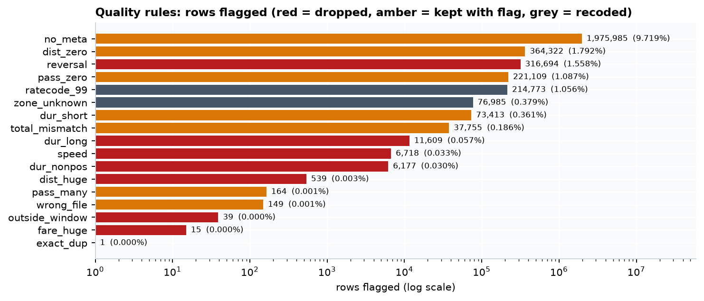

تعداد سطرهایی که هر قاعده پرچم می‌زند (محور لگاریتمی). قرمز = حذف، کهربایی = نگه‌داشتن با پرچم، خاکستری = کدگذاری دوباره یا خارج کردن از پنل.

| قاعده | سطرها | درصد | تصمیم |
|---|---|---|---|
| بلوک فراداده‌ی گمشده (payment_type = 0) | 1,975,985 | 9.72 | نگه‌داشتن برای تقاضا؛ کنار گذاشتن از مدل‌های کرایه |
| مسافت صفر | 364,322 | 1.79 | نگه‌داشتن برای تقاضا؛ کنار گذاشتن از تحلیل سرعت و کرایه |
| کرایه/مبلغ منفی (برگشت یا ابطال) | 316,694 | 1.56 | حذف سطر منفی؛ جفت مثبت آن نگه داشته می‌شود |
| passenger_count = 0 | 221,109 | 1.09 | «نامعلوم» در نظر گرفته می‌شود |
| RatecodeID = 99 (خارج از دیکشنری) | 214,773 | 1.06 | گمشده در نظر گرفته می‌شود |
| ناحیه‌ی مبدأ ۲۶۴/۲۶۵ (نامعلوم) | 76,985 | 0.38 | خارج از پنل ناحیه‌ای |
| مدت کمتر از ۱ دقیقه با مسافت مثبت | 73,413 | 0.36 | پرچم |
| total ≠ مجموع اجزا (پس از قرارداد vendor) | 37,755 | 0.19 | پرچم |
| مدت بیش از ۵ ساعت | 11,609 | 0.057 | حذف |
| سرعت ضمنی بیش از ۸۰ mph | 6,718 | 0.033 | حذف |
| پیاده‌شدن هم‌زمان یا قبل از سوارشدن | 6,177 | 0.030 | حذف |
| مسافت بیش از ۲۰۰ مایل | 539 | 0.003 | حذف |
| ماه سفر ≠ ماه فایل (داخل بازه) | 149 | 0.001 | نگه‌داشتن |
| خارج از بازه (۲۰۰۲ تا ۲۰۲۶) | 39 | 0.0002 | حذف |
| کرایه بیش از ۱۰۰۰ دلار | 15 | 0.0001 | حذف |
| **اجتماع قواعد حذف** | **341,105** | **1.68** | **۱۹٬۹۹۰٬۹۸۸ سفر پاک** |

Table: قواعد کیفیت و تصمیم اولیه. خروجی کامل: <code>tables/quality_rules.csv</code>.

**ناسازگاری ظاهری مبلغ کل یک قرارداد کدگذاری است، نه خطا.** اگر total را با جمع ساده‌ی همه‌ی اجزا مقایسه کنیم، **۲۹٫۱٪** سطرها ناسازگار به نظر می‌رسند. اختلاف همیشه دقیقاً ۲٫۵۰± یا ۱٫۷۵ یا ۴٫۲۵ دلار است. علت این است که vendor ۱ عوارض congestion (۲٫۵۰) و فرودگاه (۱٫۷۵) را درون ستون `extra` هم می‌گذارد، و در بلوک فراداده‌ی گمشده عوارض ۲٫۵۰ دلاری دریافت شده ولی در ستون خودش ثبت نشده است. با این قرارداد، ناسازگاری به **۰٫۱۹٪** کاهش می‌یابد.

**برگشت‌ها.** از ۳۱۶٬۶۹۴ سطر منفی، ۲۲۶٬۰۶۸ (۷۱٪) یک جفت مثبت دقیق دارند (همان vendor، زمان‌ها، نواحی و |کرایه|). یعنی این سطرها اصلاحیه‌ی یک سفر واقعی‌اند، نه سفر جدید. برای شمارش تقاضا فقط سطر منفی حذف می‌شود، چون سفر واقعاً انجام شده است.

### سازوکار گمشدگی

پنج ستون `passenger_count`، `RatecodeID`، `store_and_fwd_flag`، `congestion_surcharge` و `Airport_fee` **دقیقاً در همان ۱٬۹۷۵٬۹۸۵ سطر** با هم گم شده‌اند. همه‌ی این سطرها `payment_type = 0` (Flex Fare) دارند. آزمون‌ها نشان می‌دهند این گمشدگی **تصادفی (MCAR) نیست**:

- سهم بلوک بین vendorها تقریباً برابر است (۹٫۵٪ و ۹٫۸٪)، ولی هر ۱٬۲۴۸ سطر vendor ۶ در این بلوک‌اند (χ² با p < 0.001).
- سهم بلوک با زمان تغییر می‌کند: از ۴٫۷٪ در ژانویه به حدود ۱۱–۱۲٪ از مارس به بعد، و از ۵٫۲٪ در ساعت ۱۰ صبح تا ۲۶٫۲٪ در ساعت ۴ صبح.
- میانه‌ی کرایه در این بلوک بیشتر است: ۱۷٫۶۱ دلار در برابر ۱۲٫۸۰ دلار (Mann–Whitney، p < 0.001).

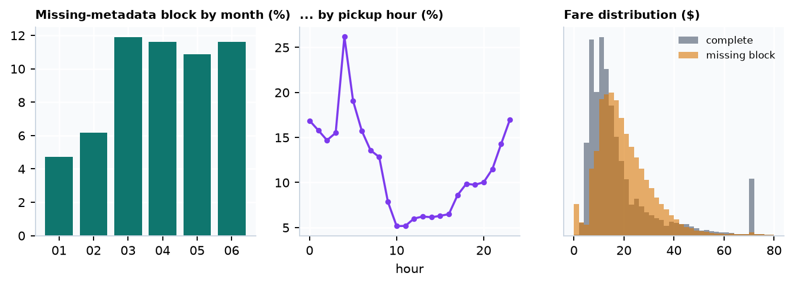

بلوک فراداده‌ی گمشده بر حسب ماه و ساعت، و توزیع کرایه‌ی آن در مقایسه با سطرهای کامل. پیک ۷۰ دلاری در سطرهای کامل، کرایه‌ی ثابت فرودگاه JFK است.

سازوکار گمشدگی در بهترین حالت MAR است (به زمان و نوع سفر وابسته است). حذف این سطرها تقاضای شبانه را حدود یک‌چهارم کمتر نشان می‌داد. برای همین **برای شمارش تقاضا همه‌ی این سطرها نگه داشته می‌شوند** و برای تحلیل‌های مسافر یا کرایه، یک شاخص گمشدگی به‌همراه مقدار «نامعلوم» به کار می‌رود، نه جایگزینی با میانگین.

## ممیزی زمان سفر

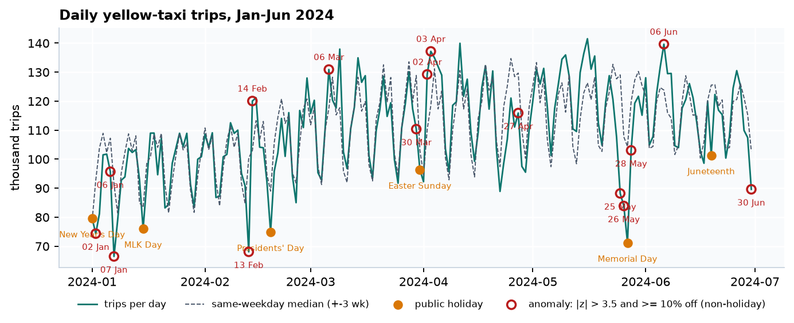

تعداد سفر روزانه در برابر میانه‌ی همان روز هفته در پنجره‌ی ±۳ هفته. نقطه‌های کهربایی تعطیلات رسمی‌اند و دایره‌های قرمز روزهایی هستند که هم z مقاوم بیش از ۳٫۵ دارند و هم دست‌کم ۱۰٪ از مقدار مورد انتظار فاصله دارند.

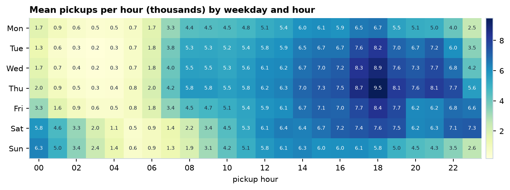

میانگین سوارشدن در هر ساعت (هزار سفر) بر حسب روز هفته و ساعت.

- **روند و فصل:** میانگین روزانه ۱۰۹٬۸۴۱ سفر است. تعداد سفر ماهانه از ۲٫۹۲ میلیون در ژانویه به ۳٫۶۶ میلیون در مه می‌رسد (+۲۵٪). این روند اهمیت تقسیم زمانی را نشان می‌دهد، چون میانگین آموزش از سطح ماه‌های بعد کمتر است.
- **ساعت:** اوج ساعت ۱۸ و کف ساعت ۴ صبح است (نسبت ۱۲٫۲). صبح‌های آخر هفته در ساعت‌های ۰ تا ۳ از روزهای کاری شلوغ‌ترند (اثر شب‌گردی).
- **روز هفته:** پنجشنبه شلوغ‌ترین روز (۱۲۳٬۵۲۷ سفر در روز) و دوشنبه خلوت‌ترین (۹۱٬۹۶۱) است.
- **ساعت گمشده:** در کل ۴٬۳۶۸ ساعت بازه، فقط یک ساعت هیچ سفری ندارد: **۲۰۲۴-۰۳-۱۰ ساعت ۰۲:۰۰**، یعنی ساعتی که با شروع ساعت تابستانی وجود ندارد. پنل ساعتی باید این ساعت را «ناموجود» در نظر بگیرد، نه «صفر تقاضا». کم‌ترین ساعت واقعی ۱۳۶ سفر دارد.
- **زمان‌های غیرممکن:** ۳۹ سفر خارج از بازه‌اند (از ۲۰۰۲-۱۲-۳۱ تا ۲۰۲۶-۰۶-۲۶) و ۱۴۹ سفر در فایل ماه دیگری منتشر شده‌اند. نمونه‌های ۲۰۰۲ احتمالاً ساعت تنظیم‌نشده‌ی تاکسی‌مترند.

| تاریخ | سفر | مورد انتظار | انحراف | توضیح احتمالی |
|---|---|---|---|---|
| 2024-01-02 | 74,316 | 92,734 | −19.9% | روز پس از سال نو |
| 2024-01-06 / 07 | 95,668 / 66,451 | 107,214 / 91,338 | −10.8% / −27.2% | آخر هفته‌ی پس از تعطیلات؛ برای بررسی با داده‌ی هوا |
| 2024-02-13 | 68,047 | 100,381 | −32.2% | هم‌زمان با برف ۱۳ فوریه؛ باید با داده‌ی NOAA تأیید شود |
| 2024-02-14 | 120,031 | 102,967 | +16.6% | روز ولنتاین و جبران روز قبل (فرضیه) |
| 2024-03-30 | 110,344 | 128,855 | −14.4% | شنبه‌ی پیش از عید پاک |
| 2024-04-02 / 03 | 129,206 / 137,142 | 110,173 / 118,520 | +17.3% / +15.7% | نامعلوم؛ نامزد بررسی با داده‌ی هوا |
| 2024-05-25 تا 28 | 88,175 … 103,021 | 129,031 … 119,739 | −14% تا −32% | آخر هفته‌ی طولانی Memorial Day |
| 2024-06-30 | 89,585 | 102,773 | −12.8% | نامعلوم |

Table: نمونه‌ای از ۱۶ روز غیرعادی (فهرست کامل در <code>tables/daily_anomalies.csv</code>). علت‌ها فرضیه‌اند و با داده‌ی بیرونی (مثل هوا) آزموده نشده‌اند.

روزهای غیرعادی دو نوع‌اند: **رخداد واقعی** (تعطیلات، برف، آخر هفته‌ی طولانی) که داده‌ی معتبری است و مدل باید آن را از تقویم یاد بگیرد، و **خطای داده** (ساعت ۲۰۰۲، ساعت تابستانی) که باید پیش از مدل‌سازی برطرف شود.

## سازگاری متغیرهای سفر

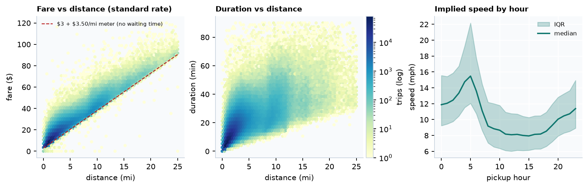

رابطه‌ی کرایه، مسافت و مدت برای سفرهای نرخ استاندارد (نمونه‌ی ۱ میلیونی)، و سرعت ضمنی بر حسب ساعت. خط‌چین قرمز کف تاکسی‌متر است: ۳ دلار + ۰٫۷۰ دلار به ازای هر ۱/۵ مایل.

- همبستگی رتبه‌ای اسپیرمن: مسافت–کرایه = ۰٫۹۲، مدت–کرایه = ۰٫۹۷، مسافت–مدت = ۰٫۸۳. کرایه بیشتر از مسافت به **مدت** وابسته است، چون تاکسی‌متر در ترافیک بر اساس زمان حساب می‌کند.
- تقریباً هیچ سفری زیر خط کف تاکسی‌متر نیست (۰٫۰۰۹٪ با کرایه‌ی کمتر از ۳ دلار). میانه‌ی کرایه به ازای هر مایل ۷٫۴۵ دلار است، یعنی حدود دو برابر نرخ پایه‌ی مسافت. این اختلاف سهم زمان انتظار در ترافیک است.
- **سرعت ضمنی** یک الگوی روزانه‌ی معقول دارد: میانه از ۸٫۱ mph در ساعت ۱۵ تا ۱۶٫۱ mph در ساعت ۵ صبح. سرعت بیش از ۸۰ mph (۶٬۷۱۸ سفر) غیرممکن است و حذف شد.
- خوشه‌ی افقی در کرایه‌ی ۷۰ دلار، کرایه‌ی ثابت JFK–منهتن است (RatecodeID = 2، برابر ۳٫۶٪ سفرها). در مدل‌های کرایه باید جدا در نظر گرفته شود.

## ساخت‌نمای مکانی اولیه

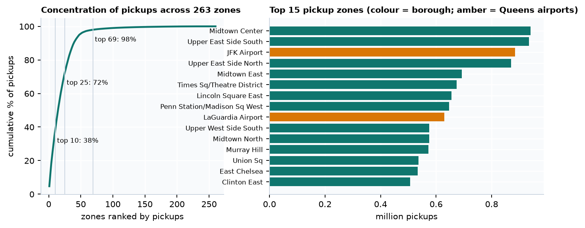

منحنی تمرکز سوارشدن در ۲۶۳ ناحیه و ۱۵ ناحیه‌ی پرتقاضا (سبز = منهتن، کهربایی = فرودگاه‌های کوئینز).

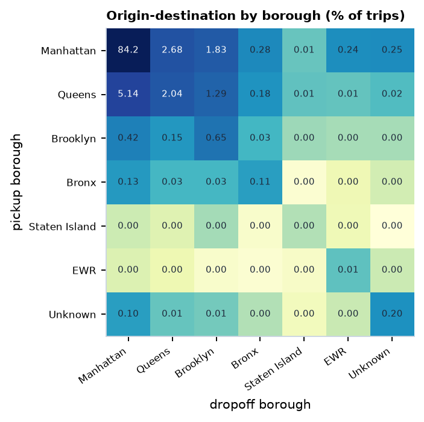

ماتریس مبدأ–مقصد در سطح borough (درصد از کل سفرهای پاک).

- نواحی به‌شدت نامتوازن‌اند: ۱۰ ناحیه ۳۷٫۷٪، ۲۵ ناحیه ۷۲٪ و ۶۹ ناحیه ۹۸٪ سوارشدن‌ها را دارند (جینی = ۰٫۸۵۵). ۳۸ ناحیه کمتر از یک سوارشدن در روز دارند.
- منهتن ۸۹٫۵٪، کوئینز ۸٫۹٪ (بیشتر فرودگاه‌ها)، بروکلین ۱٫۲۵٪ و برانکس ۰٫۲۹٪ سوارشدن‌ها را دارند. **۸۴٫۲٪** همه‌ی سفرها درون منهتن است.
- دو فرودگاه JFK و LaGuardia با هم ۷٫۶٪ سوارشدن‌ها را دارند. الگوی ساعتی آن‌ها با بقیه‌ی شهر فرق دارد و به برنامه‌ی پروازها وابسته است (شکل ۱۰).
- پیامد برای مدل: خطای کل را چند ده ناحیه‌ی پرتقاضا تعیین می‌کنند. برای همین در کنار WAPE کلی، خطا برای گروه‌های ناحیه (منهتن مرکزی، فرودگاه، بیرون منهتن) جداگانه گزارش می‌شود.

## تحلیل تک‌متغیره و چندمتغیره

| متغیر | n | میانگین | میانه | انحراف معیار | IQR | صدک ۱ | صدک ۹۹ | چولگی |
|---|---|---|---|---|---|---|---|---|
| trip_distance (mi) | 19,990,988 | 3.30 | 1.76 | 4.33 | 2.28 | 0.00 | 19.84 | 3.1 |
| duration_min | 19,990,988 | 16.21 | 12.58 | 13.33 | 12.60 | 1.12 | 67.75 | 2.7 |
| speed_mph | 19,990,988 | 10.87 | 9.37 | 6.43 | 5.86 | 0.00 | 34.62 | 1.9 |
| fare_amount ($) | 19,990,988 | 19.43 | 13.50 | 17.68 | 12.60 | 3.70 | 77.20 | 4.1 |
| tip_amount ($) | 19,990,988 | 3.32 | 2.66 | 4.01 | 4.20 | 0.00 | 17.54 | 3.7 |
| total_amount ($) | 19,990,988 | 28.18 | 21.00 | 22.19 | 14.15 | 8.40 | 104.88 | 3.4 |
| passengers | 18,076,152 | 1.33 | 1 | 0.83 | 0 | 0 | 5 | 3.0 |

Table: آمار خلاصه‌ی متغیرهای اصلی پس از پاک‌سازی. همه‌ی متغیرهای پیوسته چوله به راست‌اند، پس میانه و IQR معیار مناسب‌تری از میانگین و انحراف معیارند.

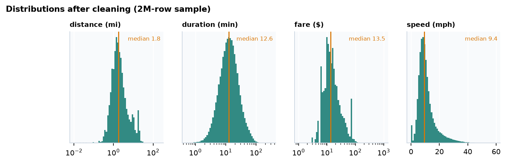

توزیع مسافت، مدت و کرایه (محور لگاریتمی) و سرعت. خط کهربایی میانه است.

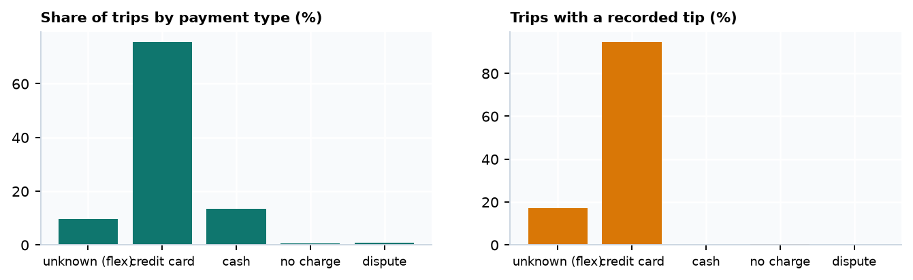

نوع پرداخت و سهم سفرهایی که انعام ثبت‌شده دارند. انعام نقدی در داده دیده نمی‌شود.

| نوع پرداخت | سهم سفرها | سفرهای دارای انعام ثبت‌شده |
|---|---|---|
| کارت اعتباری | 75.5% | 94.6% |
| نقد | 13.5% | 0.005% |
| نامعلوم (Flex Fare) | 9.6% | 17.0% |
| اختلاف/اعتراض | 0.9% | 0.13% |
| بدون هزینه | 0.5% | 0.27% |

Table: پرداخت و انعام (نمونه‌ی ۲ میلیونی). سهم vendor ۲ برابر ۷۵٫۴٪ و vendor ۱ برابر ۲۴٫۶٪ است.

## سؤال سری زمانی و پنل ناحیه–ساعت

**تعریف دقیق.** برای هر ناحیه‌ی فعال z و هر ساعت h، مقدار y(z, h) تعداد سفرهایی است که در آن ساعت در آن ناحیه آغاز شده‌اند. پیش‌بینی در نیمه‌شب روز D برای ۲۴ ساعت روز D+1 صادر می‌شود، پس هر ویژگی باید دست‌کم ۲۴ ساعت قدیمی‌تر از هدف باشد. پنل کامل ۲۶۳ × ۴٬۳۶۸ = ۱٬۱۴۸٬۷۸۴ ناحیه–ساعت دارد و ساعت‌های بدون سفر با صفر پر شده‌اند.

- **ناحیه‌ی فعال:** ناحیه‌ای که در دوره‌ی **آموزش** دست‌کم ۱۰ سوارشدن در روز داشته باشد. ۱۳۴ ناحیه این شرط را دارند و ۹۹٫۵۵٪ سوارشدن‌های دوره‌ی آموزش را پوشش می‌دهند. این فهرست فقط از داده‌ی آموزش ساخته شده تا از آینده اطلاعاتی به آن نرسد.
- در نواحی فعال، میانگین ۳۳٫۹، میانه ۲ و بیشینه ۸۳۸ سوارشدن در ساعت است، و **۲۷٫۶٪** ناحیه–ساعت‌ها صفرند. هدف، شمارشیِ پرصفر و پراکنده است؛ به همین دلیل MAPE (که روی صفر تعریف نمی‌شود) کنار گذاشته شد و WAPE معیار اصلی است.

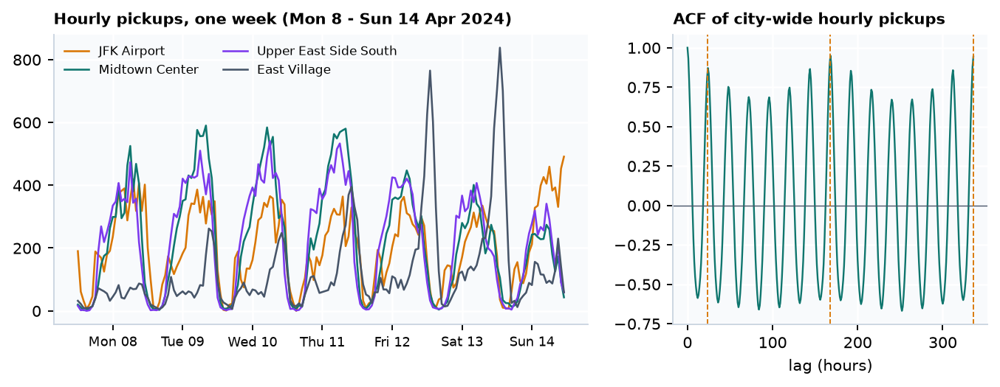

چپ: سری ساعتی چهار ناحیه در یک هفته. فرودگاه JFK الگوی متفاوتی دارد و East Village در شب‌های آخر هفته اوج دارد. راست: خودهمبستگی سری ساعتی کل شهر، با قله‌هایی در تأخیرهای ۲۴، ۱۶۸ و ۳۳۶ ساعت.

خودهمبستگی در تأخیر ۱۶۸ ساعت (یک هفته) از تأخیر ۲۴ ساعت بیشتر است، چون الگوی روز کاری با آخر هفته فرق دارد. پس «همان ساعت هفته‌ی قبل» خط مبنای طبیعی‌تری از «همان ساعت دیروز» است، و جدول ۷ هم همین را تأیید می‌کند. نواحی هم الگوی هفتگی متفاوتی دارند (اداری، تفریحی شبانه، فرودگاه). این تفاوت پایه‌ی بخش بدون ناظر پیشنهادی (بخش ۱۳) است.

## خطر نشت اطلاعات

اطلاعاتی که در لحظه‌ی صدور پیش‌بینی (نیمه‌شب روز D) **در دسترس نیست** و نباید وارد مدل شود:

- **تأخیرهای کمتر از ۲۴ ساعت** (مثل `lag_1`) و آماره‌های غلتانی که ساعت‌های روز D را شامل می‌شوند.
- **ویژگی‌های پس از سفر** مانند مدت، مسافت، کرایه، انعام و مقصد. این‌ها پس از پیاده‌شدن معلوم می‌شوند. در پیش‌بینی تقاضا فقط از شمارش‌های گذشته استفاده می‌شود.
- **آماره‌های سراسری** (میانگین ناحیه، scaler، فهرست نواحی فعال، کدگذاری هدف) که روی کل شش ماه حساب شوند. همه فقط روی آموزش fit می‌شوند.
- **داده‌ی هوای واقعی روز هدف.** در عمل فقط پیش‌بینی هوا در دسترس است.
- **اصلاحیه‌های بعدی TLC.** فایل‌های بازنشرشده سفرهای اصلاح‌شده‌ای دارند که در زمان واقعی وجود نداشتند. این را به‌عنوان محدودیت گزارش می‌کنیم.

**نمایش عملی.** یک مدل gradient boosting یکسان با سه طراحی ارزیابی شد:

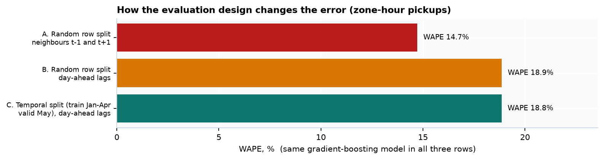

خطای یک مدل یکسان در سه طراحی. A از ساعت قبل و بعد (t−1 و t+1) استفاده می‌کند. این کار فقط با تقسیم تصادفی سطرها ممکن است و در عمل وجود ندارد.

| طراحی | ویژگی‌ها | MAE | RMSE | WAPE |
|---|---|---|---|---|
| A. تقسیم تصادفی + همسایه‌های t−1 و t+1 | zone, hour, dow, lag_1, lead_1 | 4.97 | 11.28 | 14.7% |
| B. تقسیم تصادفی + تأخیرهای مجاز | zone, hour, dow, lag_24, lag_168 | 6.36 | 15.30 | 18.9% |
| C. تقسیم زمانی + تأخیرهای مجاز | zone, hour, dow, lag_24, lag_168 | 6.86 | 16.83 | 18.8% |

Table: نمایش نشت روی نواحی فعال (ژانویه تا مه). خروجی: <code>tables/leakage_designs.csv</code>.

تقسیم تصادفی **به‌همراه ویژگی همسایه‌ی زمانی** خطا را حدود ۲۲٪ کمتر از واقع نشان می‌دهد (WAPE ۱۴٫۷٪ در برابر ۱۸٫۸٪). وقتی فقط تأخیرهای مجاز به کار می‌روند، WAPE دو تقسیم تقریباً برابر است، ولی MAE و RMSE در تقسیم زمانی بدترند و سوگیری مثبت (+۰٫۳۵) دارد، چون تقاضای مه از سطح آموزش بالاتر است. پس خطر اصلی **ویژگی‌هایی است که از آینده می‌آیند**. تقسیم زمانی هم لازم است تا اثر تغییر سطح تقاضا در ارزیابی دیده شود.

## طراحی تقسیم و خط مبنا

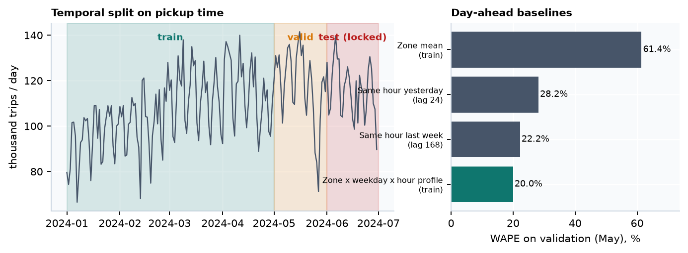

تقسیم زمانی روی زمان سوارشدن، و WAPE چهار خط مبنای یک‌روز‌جلوتر روی ماه اعتبارسنجی.

| بخش | بازه | ساعت | سوارشدن (نواحی فعال) | میانگین ساعتی هر ناحیه |
|---|---|---|---|---|
| آموزش | 2024-01-01 → 2024-04-30 | 2,904 | 12,753,266 | 32.8 |
| اعتبارسنجی | 2024-05-01 → 2024-05-31 | 744 | 3,626,067 | 36.4 |
| آزمون (قفل) | 2024-06-01 → 2024-06-30 | 720 | 3,440,254 | 35.7 |

Table: تقسیم زمانی. ماه ژوئن در هیچ تحلیلی از فاز ۱ امتیازدهی نشده است.

- **واحد تقسیم، زمان است**، نه سطر یا ناحیه. هدف، پیش‌بینی آینده‌ی همان نواحی است، پس تقسیم بر اساس ناحیه معنا ندارد.
- **مرز ساعت تابستانی** و ساعت‌های گمشده از ارزیابی حذف می‌شوند.
- **Memorial Day در مجموعه‌ی اعتبارسنجی** است، پس رفتار مدل در تعطیلات قبل از آزمون دیده می‌شود. Juneteenth در آزمون است.

| خط مبنا (یک‌روز‌جلوتر) | MAE | RMSE | WAPE | سوگیری |
|---|---|---|---|---|
| میانگین ناحیه (آموزش) | 22.34 | 49.72 | 61.4% | −3.60 |
| همان ساعت دیروز (lag 24) | 10.25 | 27.60 | 28.2% | −0.05 |
| همان ساعت هفته‌ی قبل (lag 168) | 8.08 | 20.37 | 22.2% | +0.57 |
| **پروفایل ناحیه × روز هفته × ساعت (آموزش)** | **7.27** | **18.52** | **20.0%** | **−3.30** |

Table: خط‌های مبنا روی ماه اعتبارسنجی (۱۳۴ ناحیه × ۷۴۴ ساعت). خروجی: <code>tables/baselines_valid.csv</code>.

**معیار اصلی** WAPE است (مجموع خطای مطلق تقسیم بر مجموع تقاضا)، چون برای سری‌های پرصفر پایدار است و تفسیر عملیاتی روشنی دارد. معیارهای ثانویه MAE، RMSE (حساس به خطای ساعت‌های اوج)، سوگیری، و **WAPE ساعت‌های اوج** و هر گروه ناحیه‌اند. بازه‌ی اطمینان با bootstrap روی روزها ساخته می‌شود. **خط مبنایی که باید از آن بهتر بود، پروفایل ناحیه × روز هفته × ساعت با WAPE برابر ۲۰٫۰٪ است.** سوگیری منفی آن (−۳٫۳) نشان می‌دهد روند صعودی تقاضا را نمی‌بیند.

## بخش‌های پیشنهادی، اخلاق و محدودیت‌ها

### بخش بدون ناظر پیشنهادی (بند ۱۲ کارت پروژه)
- خوشه‌بندی **نواحی** بر اساس پروفایل هفتگی ۱۶۸‌بُعدی نرمال‌شده (شکل الگو، نه حجم) با k-means و خوشه‌بندی سلسله‌مراتبی. تعداد خوشه با silhouette و پایداری روی چند seed و زیرنمونه‌ی هفته‌ها انتخاب می‌شود. نام‌گذاری مورد انتظار: «اداری روز کاری»، «تفریحی شبانه»، «فرودگاه»، «مسکونی».
- PCA روی همان پروفایل‌ها برای مصورسازی، و خوشه‌بندی **روزها** برای جدا کردن روزهای تعطیل و غیرعادی.

### بخش توسعه‌یافته‌ی پیشنهادی مسیر: سری زمانی و رخداد (بند ۱۳ کارت پروژه)
- پیش‌بینی یک‌روز‌جلوتر با ارزیابی rolling-origin، و مقایسه‌ی مدل خطی با ویژگی‌های تقویمی، gradient boosting و مدل شمارشی.
- تشخیص ناهنجاری روزانه و ناحیه–ساعتی بر اساس باقیمانده‌ی پیش‌بینی، با جدا کردن «خطای داده» از «رخداد واقعی» به کمک تقویم تعطیلات و داده‌ی هوا.
- تحلیل پایداری: آیا خطا از ماه اعتبارسنجی تا آزمون تغییر می‌کند؟ (drift در سطح تقاضا)

### ریسک‌های اخلاقی، حریم خصوصی و سوگیری
- **حریم خصوصی:** داده شناسه‌ی راننده، مسافر یا مختصات ندارد، ولی ترکیب یک ناحیه‌ی کم‌تردد با زمان دقیق می‌تواند یک سفر خاص را قابل شناسایی کند (مثلاً سفر نیمه‌شب از استاتن‌آیلند به فرودگاه نیوارک). خروجی‌ها فقط **در سطح تجمیعی** منتشر می‌شوند و سلول‌های کمتر از ۱۰ سفر در گزارش گزارش نمی‌شوند.
- **سوگیری پوشش:** داده فقط تاکسی زرد را شامل می‌شود که بیشتر در منهتن فعال است. مدلی که برای بیشینه کردن سفرهای تاکسی زرد بهینه شود، ممکن است کم‌خدمتی نواحی بیرون منهتن را **تشدید کند**. برای همین خطا برای هر borough جدا گزارش می‌شود و مدل نباید برای تصمیم «کجا سرویس نده» به کار رود.
- **تقاضای محقق‌شده در برابر تقاضای واقعی:** جایی که تاکسی کم است، سفر کم ثبت می‌شود. پس مدل ممکن است «کمبود عرضه» را با «تقاضای کم» اشتباه بگیرد (حلقه‌ی بازخورد).
- **اثر بر رانندگان:** پیش‌بینی ابزار کمک‌تصمیم است و نباید برای کنترل یا جریمه‌ی رانندگان استفاده شود.
- **همبستگی در برابر علیت:** رابطه‌هایی مثل افت سفر در روز برفی همبستگی‌اند. ادعای علّی فقط با طراحی مناسب (مثلاً مقایسه با روزهای مشابه) مطرح می‌شود.
- **تغییر سیاست:** congestion pricing در ژانویه‌ی ۲۰۲۵ الگوی منهتن را تغییر داده است. مدل این پروژه برای ۲۰۲۵ به بعد معتبر نیست، مگر اینکه دوباره ارزیابی شود.

### بازتولیدپذیری
همه‌ی اعداد این گزارش را `python -m taxidemand.run_all` از فایل‌های خامی می‌سازد که checksum آن‌ها بررسی شده است (seed = 7، زمان اجرا حدود ۱٫۵ دقیقه روی یک لپ‌تاپ با ۸ گیگابایت حافظه). جدول‌ها در `artifacts/phase1/tables/`، اعداد کلیدی در `artifacts/phase1/headline.json` و شکل‌ها در `artifacts/phase1/figures/` هستند. فایل‌های خام در `tlc/downloads/` و پنل ناحیه–ساعت در `tlc/derived/` ذخیره می‌شوند. استفاده از ابزار هوش مصنوعی در `AI_USAGE.md` ثبت شده است.

### منابع

<ol class="refs">
<li>NYC Taxi & Limousine Commission. TLC Trip Record Data. nyc.gov/site/tlc/about/tlc-trip-record-data.page</li>
<li>NYC TLC. Data Dictionary — Yellow Taxi Trip Records (2024/2025 revision).</li>
<li>NYC TLC. Taxi Fare (meter rates effective 19 Dec 2022).</li>
<li>Hyndman, R. J., & Athanasopoulos, G. Forecasting: Principles and Practice, 3rd ed. OTexts, 2021.</li>
<li>Kaufman, S., Rosset, S., Perlich, C. Leakage in Data Mining: Formulation, Detection, and Avoidance. KDD 2011.</li>
</ol>
